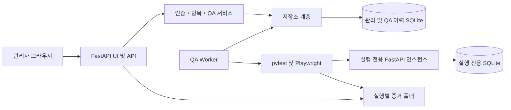
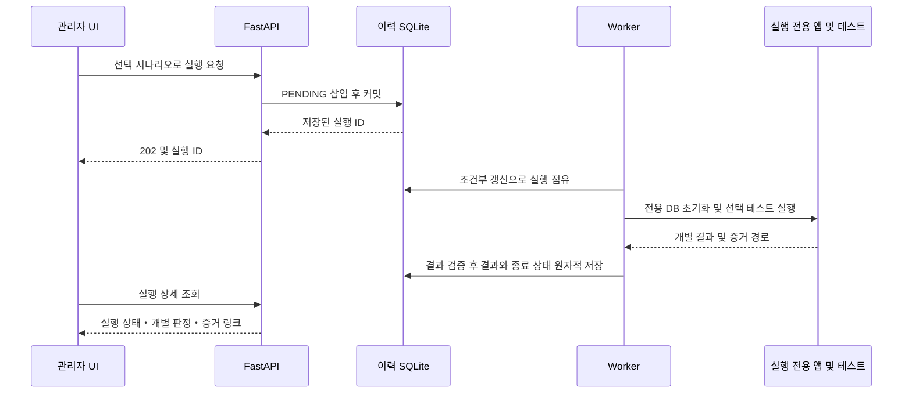

# STEP 03 시스템 아키텍처

## 실행 구조

FastAPI 기반 모듈러 모놀리스. 관리 UI와 API는 동일 출처에서 제공한다. Worker는 웹 요청과 별도 프로세스로 실행한다. MVP는 앱 인스턴스·Worker 각 1개를 기준으로 하며, DB의 조건부 갱신으로 잘못된 다중 점유를 방지한다.

| 구성 | 책임 | 연결 |
| --- | --- | --- |
| Presentation | 로그인·데이터 관리·QA 대시보드, 요청 상태 표시, 폼 유효성 피드백 | 동일 출처 API, Jinja2 및 브라우저 스크립트 |
| Routers | 요청·응답 스키마와 HTTP 상태, 세션 및 CSRF 검사 적용 | 서비스 호출, 증거 다운로드 |
| Services | 인증·등록 멱등성·수정·QA 실행·결과 수집 정책 | SQLAlchemy 저장소를 통해 트랜잭션 사용 |
| Repositories | 필드 조회·저장, 작업 조건부 점유와 상태 갱신 | 앱·Worker 공용 SQLite, Alembic 마이그레이션 |
| QA Worker | 실행 점유, 시간 제한·heartbeat, 테스트 하위 프로세스와 결과 검증 | 이력 DB, 실행용 임시 작업 공간, 보고서 디렉터리 |
| Automation | 관리 대상 앱과 동일 코드를 실행별 DB에서 기동하고 브라우저 시나리오 수행 | loopback 테스트 앱, 고정 시나리오 목록, 테스트 계정 |

## 흐름과 격리

- 정상 관리 앱과 Worker는 이력용 DB 파일을 같은 로컬 볼륨에서 공유한다. 운영 UI에서 생성한 항목과 QA 시나리오가 생성한 항목은 DB 파일이 다르다.
- Worker는 실행별 임시 작업 공간에서 고정 명령으로 pytest를 실행한다. 브라우저가 붙는 테스트 앱은 Worker 내부 loopback에서 기동하며 전용 DB와 합성 계정을 사용한다. 사용자가 URL·파일명·실행 명령을 입력하는 기능은 제공하지 않는다.
- 앱은 인증된 관리자에게 지정된 실행의 허용된 증거 파일만 제공한다. 저장 경로는 앱의 보고서 루트 하위로 제한하고 경로 자체는 API 요청에서 받지 않는다.
- 전용 DB 및 임시 환경은 결과 수집 후 정리한다. 보고서에는 필요한 로그·스크린샷 및 결과만 보존한다.

## 배포 구조 초안

Compose의 `app`은 호스트 loopback으로 관리자 포트를 공개하고 마이그레이션 후 `/health`를 제공한다. `qa-worker`는 외부 포트 없이 앱이 준비된 뒤 실행하며, 두 서비스가 로컬 `db_data`와 `qa_reports` 볼륨을 공유한다. SQLite WAL 파일과 DB는 같은 로컬 파일시스템에 둔다. 환경 변수로 DB·보고서 경로와 계정 초기화 설정을 주입한다.
