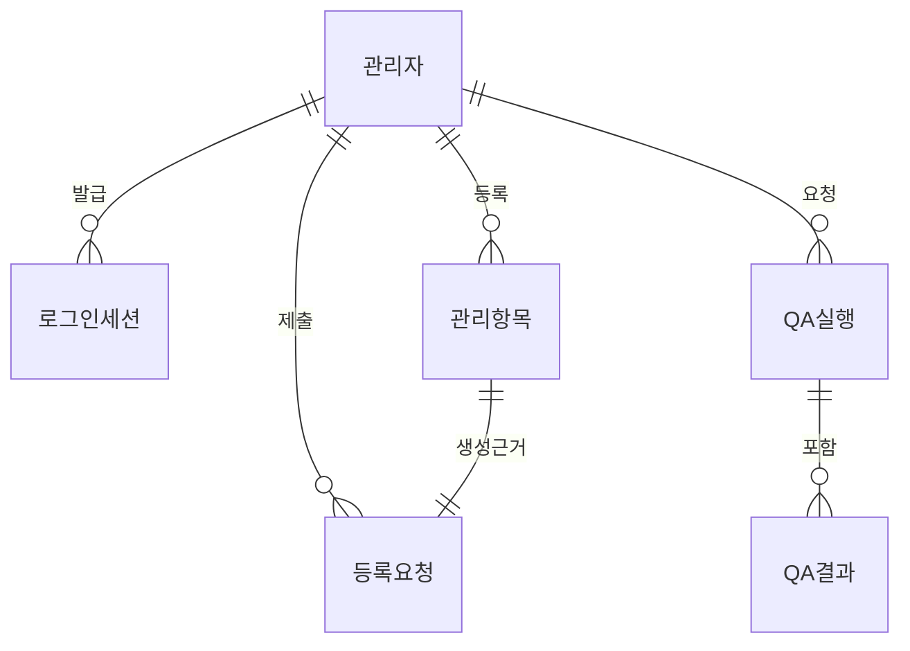
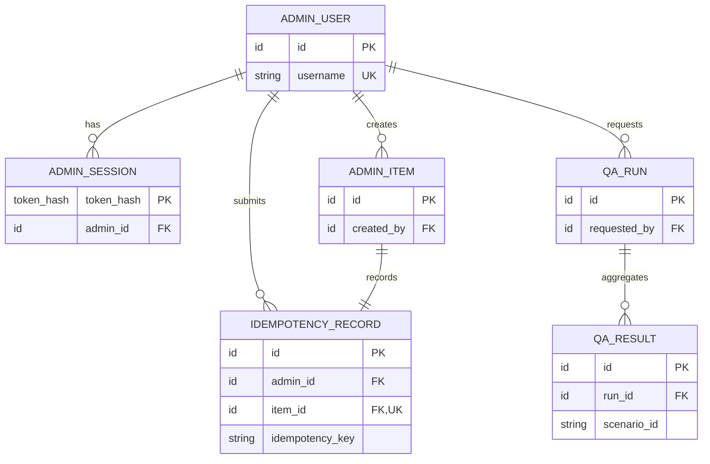
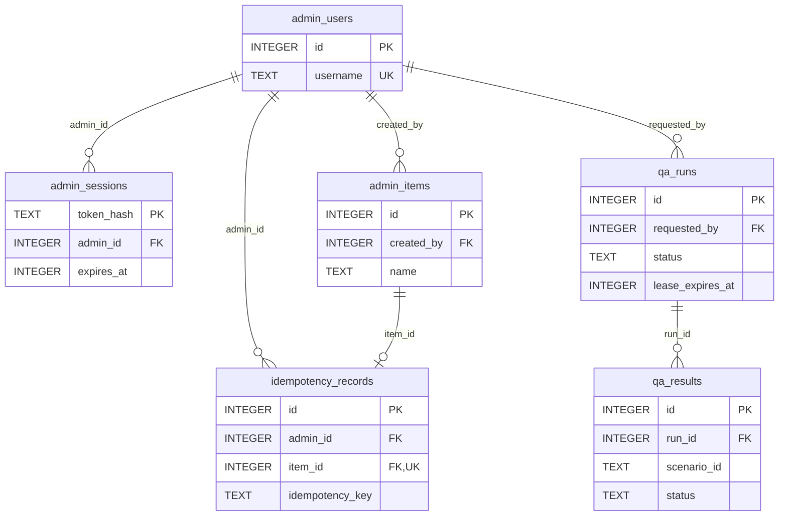

# STEP 04 데이터 모델링

## 개념 모델

관리자는 항목을 등록하고 QA 실행을 요청한다. 등록요청은 네트워크 재시도·동시 요청에서 기존 생성 결과를 식별한다. 종료된 QA 실행은 시나리오별 독립 판정을 제공한다. 로그아웃 후 세션 재사용을 막기 위해 서버에서 폐기 가능한 세션을 별도 엔터티로 둔다.

## 논리 모델

- `admin_users`: 로그인 식별자·해시, 계정의 실패 횟수 및 잠금 상태.
- `admin_sessions`: 쿠키 토큰의 해시, 소유 관리자와 만료 시각.
- `admin_items`: 항목 원문과 작성자. API를 통해 신규 생성하는 항목은 등록요청과 한 트랜잭션에서 저장.
- `idempotency_records`: 관리자별 등록 키, 본문 지문과 변경 전의 최초 응답 스냅샷. 항목이 수정된 뒤에도 같은 등록 요청의 최초 응답을 재생할 수 있음.
- `qa_runs`: 실행 요청 및 원본 시나리오 목록, 작업 점유 상태와 종료 원인.
- `qa_results`: 실행 내 시나리오별 최종 판정과 기간·근거.

## 정규화 검토

관계 데이터는 1NF를 기준으로 속성 하나에 값 하나를 저장하고, 2NF·3NF 검토에서 계정 정보와 항목 원문을 다른 엔터티에 반복하지 않는다. QA 집계는 개별 판정에서 계산한다. 순서를 가진 선택 목록과 최초 API 응답은 이력 재현을 위한 불변 JSON으로 보존한다. 조회 시 필요한 실행별 판정과 개별 시나리오 값은 `qa_results`에서 구조화한다.

## 물리 모델

물리 DB의 `item_id UNIQUE`는 항목마다 최대 한 개의 등록요청을 허용한다. 서비스의 등록 트랜잭션은 항목과 등록요청을 함께 저장해 신규 API 항목의 필수 관계를 보장한다. `UNIQUE(admin_id, idempotency_key)`와 `UNIQUE(run_id, scenario_id)`로 각각 등록 의도와 실행 내 시나리오 판정의 중복을 방지한다.

SQLite의 정수 PK, 문자열 `TEXT`, UTC Unix 초 `INTEGER`를 사용한다. QA 소요 시간은 밀리초를 별도 저장한다. 운영용 DB와 실행별 테스트 DB는 같은 마이그레이션으로 생성한다. 물리 제약·인덱스 및 보존 규칙은 데이터 사전과 STEP 05에서 확정한다.
