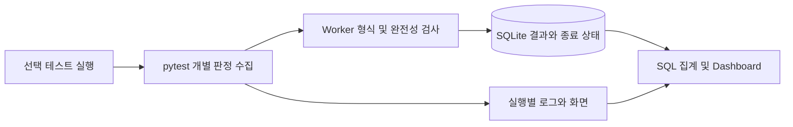

# STEP 07 QA 결과 파이프라인

테스트 완료·실패 시점에 `scenario_id`, `status`, `duration_ms`, `detail`, `screenshot_path`를 수집한다. pytest 종료 시 단일 JSON 결과를 임시 파일에 쓰고 원자적으로 교체한다. stdout·stderr는 관리 앱과 구분된 실행 로그에 기록한다. Worker는 선택 집합과 결과 집합 일치, 필드 형식, 실행 ID와 파일 경로를 검사한 후 해당 실행만 갱신한다.

이력은 SQL의 상태별 `COUNT` 및 소요 시간 합계를 집계해 `AVG(duration_ms)`와 같은 가중 평균을 계산한다. 통과율 분모는 완료 실행에서 수집한 모든 선택 판정이며 `SKIPPED`는 분자에서 제외한다. 예외 검증 통과율은 완료 실행의 `TC-EX-*` 중 PASS 비율이다. 수정 전 재현율과 수정 후 동일 조건 복구율은 STEP 15 비교 결과에서 각각 계산한다. 표본이 없으면 비율·평균은 `null`을 반환한다.
