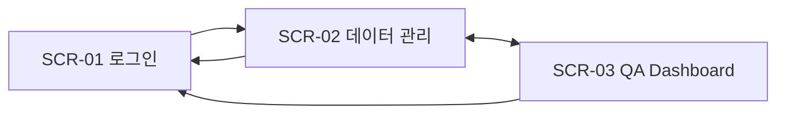

# STEP 08 UI/UX 명세



| 화면 | 화면 영역 순서 | API 및 상태 |
| --- | --- | --- |
| SCR-01 로그인 | 제품 제목 → 사용자명 → 비밀번호 → 로그인 버튼 → 상태 영역 | `POST /api/auth/login`. 제출 중 버튼 비활성, 실패 시 폼 유지, 성공 시 데이터 관리 이동 |
| SCR-02 데이터 관리 | 공통 내비게이션 → 항목 폼 → 목록 및 다음 페이지 | `/api/items`. 기본은 등록 모드, 행 편집 시 수정 모드, 취소 시 등록 상태로 복귀 |
| SCR-03 QA Dashboard | 공통 내비게이션 → 통과·실패 집계 → 시나리오 선택 → 실행 이력 → 결과 상세 | `/api/qa/runs`. 제출 중 재클릭 방지, 이력 자동 갱신, 실행을 선택해 결과와 로그·스크린샷 열기 |

```text
로그인                     데이터 관리                     QA Dashboard
┌ 계정 입력 ┐              ┌ 등록·수정 폼 ┐               ┌ 판정 지표 ┐
│ 로그인    │              ├ 항목 목록    ┤               ├ 시나리오 선택 ┤
└ 상태      ┘              └ 다음 페이지  ┘               └ 이력 · 상세 ┘
```

공통 상태는 대기, 로딩, 제출 중, 성공, 오류다. 제출 응답이 유실되면 데이터 등록 폼에 키와 본문을 보존하고 같은 내용의 수동 재시도를 안내한다. 본문이 바뀌면 새 등록 의도로 처리한다. 로그인 만료 후 보호 화면에서 로그인으로 이동한다.

폼 입력은 보이는 `label`과 오류 상태 영역을 연결한다. 초점 표시와 시맨틱 제목·테이블을 사용하고 색상과 함께 판정 문자열을 표시한다. 모바일에서 폼을 한 열로 배치하고 표는 영역 안에서 가로 스크롤한다. `TC-UI-01`에서 키보드 로그인과 모바일 버튼·입력 접근을 검증한다.
