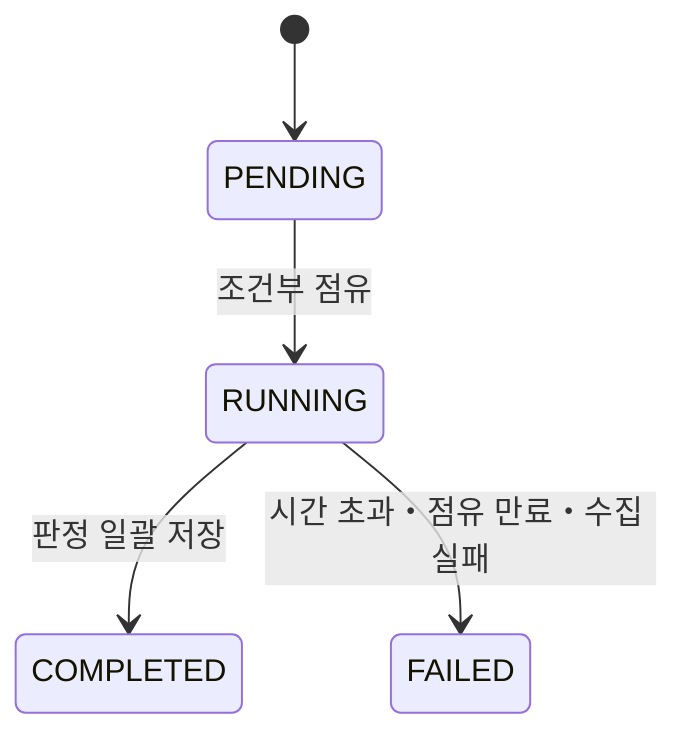

# STEP 11 장애 복구 정책

Worker는 먼저 만료 실행을 `FAILED/LEASE_EXPIRED`로 전환하고, 대기 실행을 한 건 점유한다. 5초마다 heartbeat를 기록하고 30초 임대 만료를 연장한다. 점유 약속을 잃은 프로세스는 결과 쓰기를 중단한다. QA 실행 자체 제한은 120초이며 초과 시 하위 실행을 중단하고 `TEST_TIMEOUT`을 기록한다.

DB 잠금은 SQLite 5초 제한 뒤 앱에서 503으로 반환한다. Worker는 다음 폴링에서 DB 접근을 다시 시도하고, 저장 시 동일 점유 토큰 및 만료 시각을 다시 확인한다. 결과 파일이 없거나 잘못되면 해당 실행은 `FAILED/INVALID_RESULTS`다. 기존 실행의 판정을 재사용하지 않고 관리자가 새 실행을 요청한다. 등록 응답 단절은 기존 키의 재전송으로 복구한다.
